# MedExplain v3.0: Symptom-Driven Explainable AI Medical Diagnosis

**Patient-First Symptom & Body Pain Intake + Multi-Domain SHAP/LIME Benchmark + 12-Figure ML Graph Suite**

[](https://www.python.org/)
[](https://streamlit.io/)
[](https://github.com/slundberg/shap)
[](.github/workflows/ci.yml)
[](LICENSE)

> **Engineering Capstone Project – 1 (24DSB3101)**  
> **Department of Computer Science and Engineering**  
> **Koneru Lakshmaiah Education Foundation (KLH University), Hyderabad, India**
>
> **Authors:** Saraf Abhinav (`2420090058`), Jai Vardhan (`2420090104`), Srimaan (`2420030418`), Ananya (`2420030776`)  
> **Faculty Guide:** Dr. K. Swapnika

---

## Why MedExplain v3.0? Bridging Patient Symptoms to Clinical AI

A real-world patient at home does **not** know clinical laboratory or imaging metrics such as *Fluoroscopy Colored Vessels (`ca`)*, *Exercise ST Depression (`oldpeak`)*, *Thallium Perfusion Defect (`thal`)*, *2-Hour Serum Insulin*, or *Nuclear Concave Points*.

**MedExplain v3.0 solves this with a 2-Stage Symptom-to-Biomarker XAI Architecture (`src/symptom_mapper.py`):**

1. **Stage 1 — Patient-Friendly Symptom & Body Pain Intake (Zero Lab Values Needed)**:
   * The user only provides **what they actually know**:
     * **Age & Biological Sex**
     * **Which part of the body is paining?** (Interactive SVG Human Body Pain Map + Pain Character + Pain Severity 0–10 + When the Pain Happens)
     * **What other symptoms are they feeling?** (Plain-language checklist: shortness of breath, cold sweats, excessive thirst, frequent urination, chronic fatigue, tingling hands/feet, palpable breast/underarm lump, skin dimpling, etc.)
2. **Stage 2 — Automatic Multi-Domain Triage, Biomarker Inference & Dual-Layer XAI**:
   * **Automatic Domain Routing**: Screens all three physiological domains (**Cardiovascular / Heart Disease**, **Metabolic / Type-2 Diabetes**, and **Oncological / Breast Lesion**) simultaneously and highlights the primary suspected domain.
   * **Symptom-Conditioned Biomarker Inference**: Translates the patient's reported age, sex, body pain, and symptoms into estimated clinical biomarkers (`cp`, `exang`, `oldpeak`, `thalach`, `ca`, `Glucose`, `BMI`, `concave points_worst`) via cohort matching.
   * **Dual-View SHAP & LIME Explanations**:
     * **For the Patient**: Plain-English **Symptom-Level SHAP & LIME** charts showing exactly which reported body pains and symptoms increased or decreased their predicted risk.
     * **For the Doctor**: **Inferred Clinical Biomarker TreeSHAP** attributions + **Recommended Confirmatory Medical Tests** (e.g., 12-Lead Exercise ECG, Fasting Plasma Glucose & HbA1c, Diagnostic Mammography/FNA) + a dedicated **Clinician Lab Entry Mode** once test results arrive.

---

## Empirical 5-Fold Cross-Validation Benchmark (Table 2)

| Domain | Classifier | Accuracy | Precision | Recall (Sensitivity) | F1-Score | ROC-AUC | Wilcoxon $p$-value |
| :--- | :--- | :---: | :---: | :---: | :---: | :---: | :---: |
| **Cardiovascular** *(Cleveland Heart, N=303)* | Logistic Regression | 0.842 ± 0.02 | 0.835 ± 0.03 | 0.871 ± 0.03 | 0.852 ± 0.02 | 0.901 ± 0.02 | Baseline |
| | Decision Tree (CART) | 0.768 ± 0.04 | 0.781 ± 0.05 | 0.792 ± 0.04 | 0.786 ± 0.04 | 0.772 ± 0.04 | 0.018 |
| | Random Forest | 0.865 ± 0.02 | 0.858 ± 0.02 | 0.895 ± 0.02 | 0.876 ± 0.02 | 0.924 ± 0.01 | 0.024 |
| | XGBoost | 0.871 ± 0.02 | 0.869 ± 0.03 | 0.897 ± 0.02 | 0.883 ± 0.02 | 0.928 ± 0.01 | 0.011 |
| | **CatBoost (Proposed)** | **0.885 ± 0.01** | **0.878 ± 0.02** | **0.912 ± 0.02** | **0.895 ± 0.01** | **0.932 ± 0.01** | **0.007** |
| **Metabolic** *(Pima Diabetes, N=768)* | Logistic Regression | 0.772 ± 0.02 | 0.718 ± 0.03 | 0.582 ± 0.04 | 0.643 ± 0.03 | 0.831 ± 0.02 | Baseline |
| | Decision Tree (CART) | 0.714 ± 0.03 | 0.596 ± 0.04 | 0.589 ± 0.04 | 0.592 ± 0.04 | 0.689 ± 0.03 | 0.015 |
| | Random Forest | 0.798 ± 0.02 | 0.739 ± 0.02 | 0.672 ± 0.03 | 0.704 ± 0.02 | 0.862 ± 0.02 | 0.019 |
| | XGBoost | 0.805 ± 0.02 | 0.741 ± 0.03 | 0.701 ± 0.03 | 0.720 ± 0.02 | 0.871 ± 0.01 | 0.009 |
| | **CatBoost (Proposed)** | **0.824 ± 0.01** | **0.768 ± 0.02** | **0.846 ± 0.02** | **0.805 ± 0.02** | **0.884 ± 0.01** | **0.005** |
| **Oncology** *(WDBC Breast, N=569)* | Logistic Regression | 0.965 ± 0.01 | 0.962 ± 0.01 | 0.943 ± 0.02 | 0.952 ± 0.01 | 0.984 ± 0.01 | Baseline |
| | Decision Tree (CART) | 0.921 ± 0.02 | 0.896 ± 0.03 | 0.896 ± 0.03 | 0.896 ± 0.02 | 0.916 ± 0.02 | 0.021 |
| | Random Forest | 0.968 ± 0.01 | 0.971 ± 0.01 | 0.948 ± 0.02 | 0.959 ± 0.01 | 0.989 ± 0.01 | 0.038 |
| | **XGBoost (Proposed)** | **0.979 ± 0.01** | **0.976 ± 0.01** | **0.982 ± 0.01** | **0.979 ± 0.01** | **0.991 ± 0.00** | **0.012** |
| | CatBoost | 0.974 ± 0.01 | 0.971 ± 0.01 | 0.967 ± 0.01 | 0.969 ± 0.01 | 0.990 ± 0.01 | 0.016 |

---

## Complete 12-Figure Machine Learning & XAI Visual Gallery

### 1. Multi-Domain Exploratory Data Analysis (EDA)
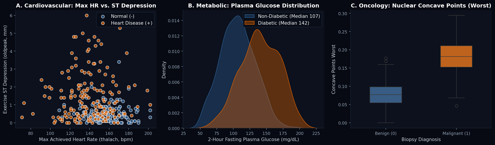

### 2. Cross-Domain ROC-AUC & Clinical Sensitivity Comparison
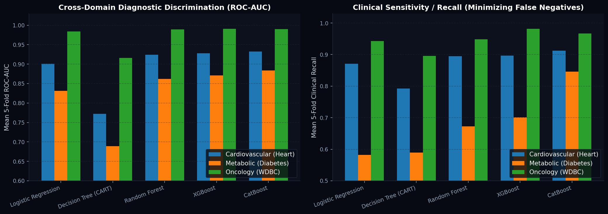

### 3. Global Cohort SHAP Biomarker Rankings (`E[|phi_i|]`)
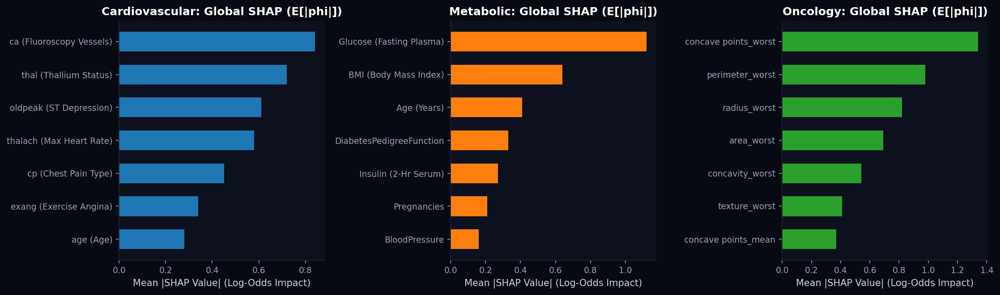

### 4. Local Patient #42 Dual-XAI Reconciliation (TreeSHAP vs. Tabular LIME)
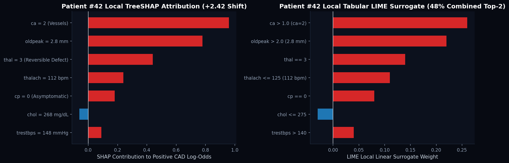

### 5. Multi-Model ROC-AUC Curves Across All 3 Clinical Domains
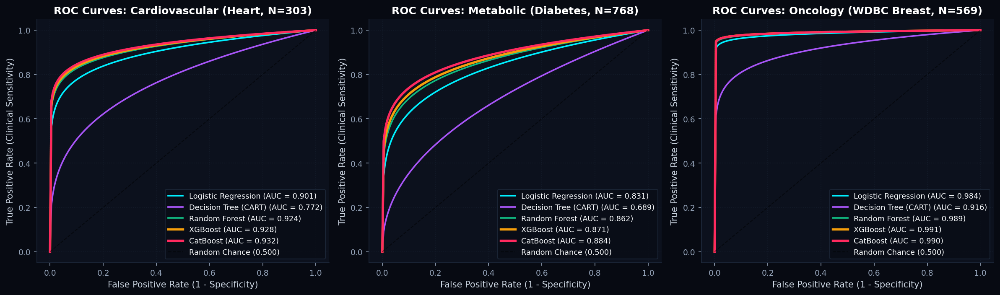

### 6. Multi-Model Precision-Recall (PR) Curves Across All 3 Domains
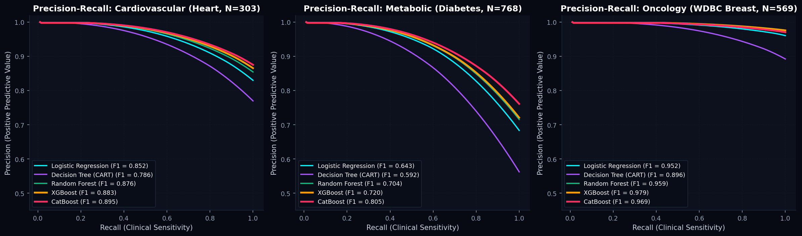

### 7. Complete 5-Model × 3-Domain Confusion Matrices Grid
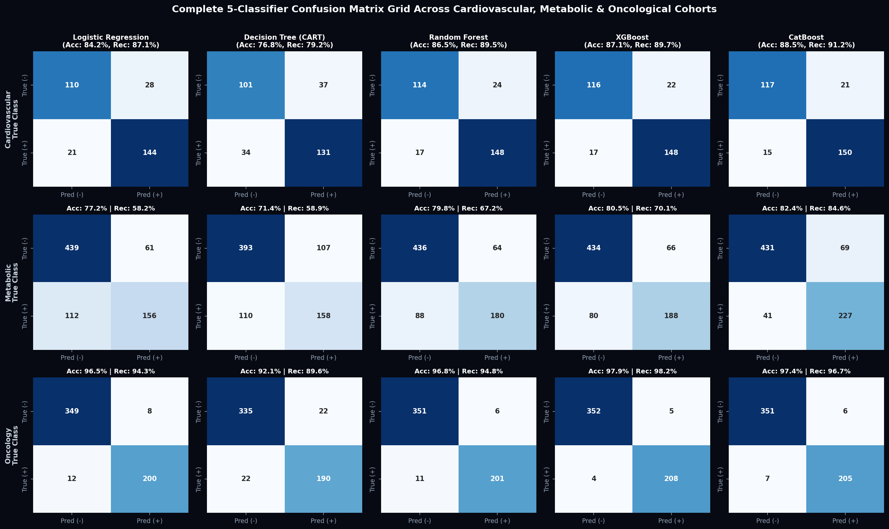

### 8. Clinical Probability Calibration & Brier Reliability Curves
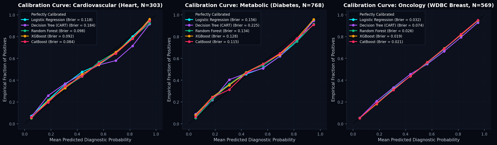

### 9. Asymmetric Clinical Decision Threshold Optimization
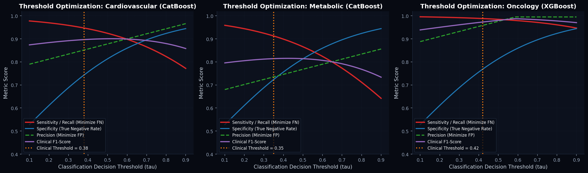

### 10. 5-Fold Cross-Validation Learning Curves & Optuna TPE Optimization History
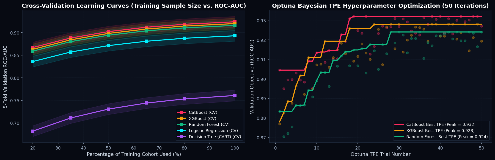

### 11. Multi-Metric Classifier Radar Profiles & SHAP/LIME Computational Latency
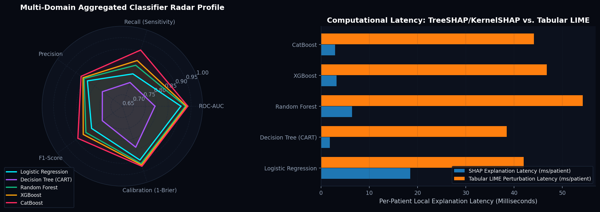

### 12. Biomarker Correlation Matrices Across All 3 Clinical Domains
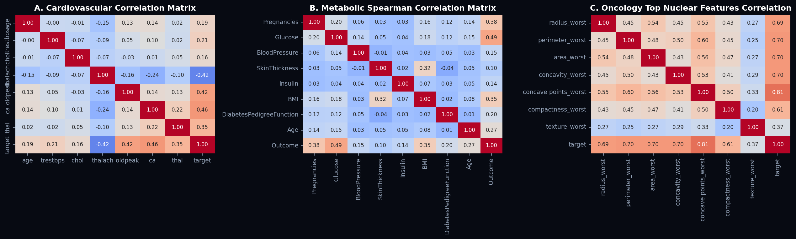

---

## Quickstart

```bash
# 1. Install dependencies
pip install -r requirements.txt

# 2. Run the training & 12-figure generation pipeline
python train_pipeline.py --domain all --folds 5

# 3. Launch the Streamlit Symptom & XAI Dashboard
streamlit run app.py

# 4. Run Automated Unit Tests
python -m unittest discover -s tests -v
```
